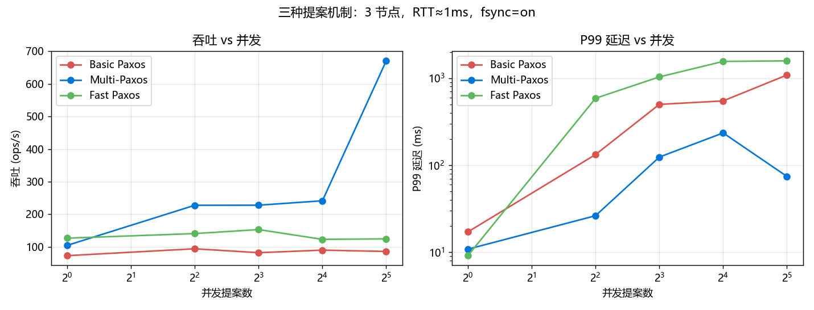

# paxos-lab —— Paxos 协议重实现与性能临界点实验

> 《云计算技术》作业5 配套工程。**纯 Python 标准库实现，零第三方依赖**，不调用任何现成的
> Paxos/Raft 库；3~5 个节点、TCP 自定义报文、可注入 RTT/丢包/分区的传输层，
> 一键跑出 Basic Paxos / Multi-Paxos / Fast Paxos 的性能对比与临界点。

[](https://www.python.org/)
[]()
[](LICENSE)

---

## 30 秒上手

```bash
git clone <this-repo> paxos-lab && cd paxos-lab
python -m paxos.cli smoke          # 环境自检：三种协议各跑一遍 + 崩溃恢复 + 安全性比对
```

看到 `===== 自检结果: 8/8 通过 =====` 就说明环境没问题。接着：

```bash
python -m paxos.cli up --nodes 4          # 终端A：起 4 节点集群（Ctrl+C 结束）
python -m paxos.cli status                # 终端B：看谁在当 Leader
python -m paxos.cli bench -c 16 -d 20     # 16 并发压 20 秒
python -m paxos.cli inject --rtt 50 --loss 0.05
python -m paxos.cli crash --node n2 --restart
python -m paxos.cli verify                # 比对所有节点的决定日志（安全性）
python -m paxos.cli down
```

一条命令跑完整套实验（约 12 分钟）：

```bash
python -m experiments.run_matrix --profile all --save-raw   # 采集数据 → results/
python -m experiments.analyze                               # 生成报告表格 → results/tables.md
python -m experiments.plots                                 # 生成报告插图 → results/figs/
```

---

## 三种提案机制，一句话说清差别

| 机制 | RTT/提案 | 谁能提案 | 关键机制 | 代价 |
|---|---|---|---|---|
| **Basic Paxos** | 2 | 任意节点 | 每个提案独立 Prepare + Accept | 并发高时互相顶掉 → 活锁 |
| **Multi-Paxos** | 1 | 仅 Leader | Leader 一次 Phase 1 接管，之后跳过 Phase 1；批处理 + 流水线 | Leader 是单点，挂了要重新选主 |
| **Fast Paxos** | 1 | 任意节点 | 任意副本把值**直投** Acceptor，快速仲裁 ⌈3n/4⌉ | 冲突时要回退经典轮，冲突率高反而更慢 |

三者共用同一条安全性命门：**Acceptor 只在提案编号不小于已承诺编号时才接受**，
于是任意两个多数派必然相交 —— 这就是 Paxos 在异步网络 + 节点崩溃下仍然正确的原因。

---

## 架构一览

```text
                         ┌────────────────────────── 一个节点进程 ──────────────────────────┐
                         │                                                                │
   客户端(压测器)          │   ┌────────────┐   ┌──────────────┐   ┌──────────────┐          │
   ──client_req──▶ :port │──▶│  Proposer  │──▶│   Acceptor   │──▶│   Learner    │          │
                         │   │ basic/mp/  │   │ promised_id  │   │ 按 slot 顺序  │          │
   ◀──chosen───────       │   │ fast 三种   │   │ accepted_id  │   │ 应用状态机     │          │
                         │   └─────┬──────┘   │ accepted_val │   └──────┬───────┘          │
                         │         │          └──────┬───────┘          │                  │
                         │         │                 │                  ▼                  │
                         │         │          ┌──────▼───────┐   ┌──────────────┐          │
                         │         │          │ acceptor.log │   │ learner.log  │          │
                         │         │          │ (fsync 可关)  │   │ (flush 即可)  │          │
                         │         │          └──────────────┘   └──────────────┘          │
                         │         ▼                                                      │
                         │  ┌───────────────┐    JSON-Lines over TCP（自定义报文）           │
                         │  │ PeerLink ×N   │◀── 可注入 RTT / 丢包 / 分区 ──▶ 其他节点       │
                         │  └───────────────┘                                              │
                         │                                                                │
                         │  admin 口 :port+1000  status / inject / crash / dump_log / ping  │
                         └────────────────────────────────────────────────────────────────┘
```

**为什么把时延注入做在应用层而不是 `tc netem`**：这样 3 台机器都不用 root、Windows 也能跑，
而且注入的是**每条消息各自**的时延（不是串行 sleep），才能测出真实的并发行为。
需要"内核级真实网络时延"时，用 `docker/` 里的 compose + `tc netem` 方案（Linux 容器）。

---

## 目录结构

```text
paxos-lab/
├── paxos/                     # 协议实现（核心，约 3500 行，纯标准库）
│   ├── ballot.py              # 提案编号 + 多数派/快速仲裁计算
│   ├── acceptor.py            # Acceptor：持久化 promised/accepted，批量落盘
│   ├── learner.py             # Learner：按 slot 顺序应用、缺口回填
│   ├── proposer.py            # 三种提案机制 + 选主 + 空槽修复
│   ├── node.py                # 节点主循环：网络、角色黏合、admin 控制口
│   ├── transport.py           # JSON-Lines 报文、链路时延/丢包注入、消息计数
│   ├── storage.py             # 追加写日志（fsync / flush / buffer 三档）
│   ├── timer.py               # Windows 高精度 sleep（否则 0.5ms 会变成 15.6ms）
│   ├── kv.py                  # 被复制的幂等 KV 状态机
│   ├── cluster.py             # 多进程集群编排（起/停/杀/分区/ping）
│   ├── loadgen.py             # 闭环压测器（P50/P95/P99、吞吐、错误分类）
│   └── cli.py                 # 命令行入口
├── experiments/               # 实验编排
│   ├── cases.py               # 用例矩阵（协议/节点数/RTT/丢包/fsync/批处理/故障）
│   ├── run_matrix.py          # 一键跑批 → results/*.csv
│   ├── analyze.py             # 汇总成报告表格 → results/tables.md
│   └── plots.py               # 出图 → results/figs/*.png
├── tests/                     # 单元测试（不需要网络）
├── docker/                    # 4 节点容器部署 + tc netem
├── scripts/                   # PowerShell 一键脚本（Windows 友好）
├── docs/                      # 作业原文、开源项目架构分析
├── results/                   # 原始数据 CSV + 图表（提交物）
├── 实验操作手册.md              # ★ 零基础逐步操作指南
└── 实验报告.md                 # ★ 报告（数据填进去即可交）
```

---

## 你会学到什么

1. **共识为什么难**：多数派、提案编号、承诺、两阶段，以及"为什么不能只靠多数派就够了"。
2. **三种机制的工程取舍**：为什么 Multi-Paxos 成为工业界标配，Fast Paxos 的收益为什么会被
   冲突吃掉，3 节点上 Fast Paxos 的快速仲裁为什么等于全体。
3. **临界点怎么测**：RTT、丢包、并发、fsync、故障 —— 每一条曲线背后的机制，而不是"数字好看"。
4. **分布式系统的真实开销**：一次 fsync 2.3ms、一次 TCP 往返 0.5ms、Windows 定时器 15.6ms，
   哪个在什么规模下成为瓶颈。
5. **安全性怎么验**：怎么用"比对所有副本的决定日志"证明"没有两个 Learner 学到不同的值"。

---

## 环境要求

| 项 | 要求 | 说明 |
|---|---|---|
| Python | 3.10+ | 协议与实验**只用标准库**；只有画图需要 matplotlib |
| 操作系统 | Windows 10/11、Linux、macOS | Windows 会自动打高精度定时器补丁，见 `paxos/timer.py` |
| 内存 | 4 个节点进程约 200MB | 5 节点也够用 |
| GNU/Linux 容器 | 可选 | 只有 `docker/` 的多机部署与 `tc netem` 才需要 |

---

## 文档导航

| 文档 | 内容 |
|---|---|
| [实验操作手册.md](实验操作手册.md) | 零基础逐章操作：概念速通 → 环境 → 三种协议跑通 → 五组实验 → Docker 多机 → 截图打包 → 上传 GitHub |
| [实验报告.md](实验报告.md) | 报告全文骨架（已按作业八节结构写好），数据来自 `results/tables.md` |
| [docs/开源项目架构分析.md](docs/开源项目架构分析.md) | etcd 架构与关键代码分析（作业评分项 20%） |
| [REPRODUCE.md](REPRODUCE.md) | 复现指南：一条命令复现全部实验数据 |

---

## 实测数据（本机：Windows 11 / Python 3.13 / 3 节点 / 实测 RTT≈1.7 ms / fsync 2.3 ms）

完整数据见 [`results/tables.md`](results/tables.md)（52 个用例 + 8 个故障场景），图见 [`results/figs/`](results/figs/)。

| 机制 | 并发1 吞吐 | 并发32 吞吐 | 并发1 P50 | 并发32 P99 | 并发1 消息/op | 并发32 消息/op |
|---|---|---|---|---|---|---|
| Basic Paxos | 72.8/s | 85.7/s | 12.9 ms | 1086.6 ms | 10.0 | 23.3 |
| Multi-Paxos | 104.4/s | **670.7/s** | 9.0 ms | 74.1 ms | 8.3 | **4.9** |
| Fast Paxos | **126.5/s** | 124.4/s | **7.4 ms** | 1579.8 ms | **6.3** | 16.3 |



> 数字会随机器变化，**趋势**才是结论：
> 低并发时 Fast Paxos 最快（省掉 Leader 一跳）；高并发时 Multi-Paxos 靠批处理反超 5~8 倍，
> 而它的"消息/op"反而**随并发下降**（唯一一个能把一次 fsync 摊给多条命令的机制）。
> Fast 的冲突率从 4.3% 涨到 33.9% 后，吞吐原地踏步、P99 破 1.5 秒——这就是它的临界点。

**安全性**：60 次实验、488 407 个 slot 的跨副本决定日志比对，**0 次**出现
"两个 Learner 学到不同值"（含杀节点、杀 Leader、2|2 与 2|3 分区）。

---

## 许可

MIT，见 [LICENSE](LICENSE)。仅用于课程学习，请勿直接提交他人成果。
