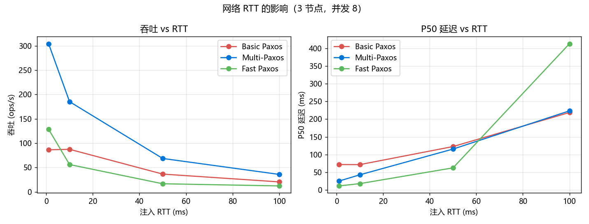
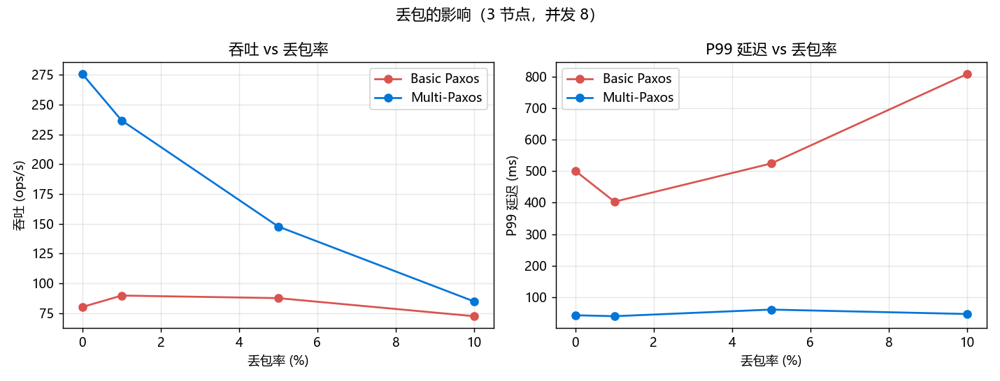
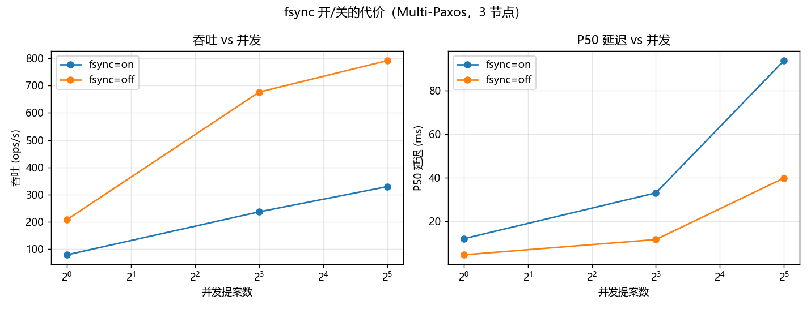
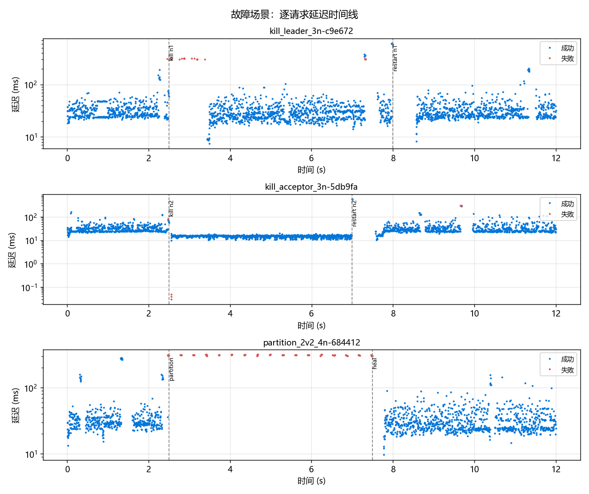

# 《云计算技术》作业5 实验报告

**题目：Chubby 类开源项目分析 + Paxos 协议重实现与性能临界点实验**

| 项目 | 内容 |
|---|---|
| 课程名称 | 云计算技术 |
| 姓名 / 学号 | 【待填】 |
| 完成日期 | 【待填】 |
| 代码仓库 | 【待填：GitHub 链接】 |
| 配套工程 | `paxos-lab/`（纯 Python 标准库实现，零第三方依赖，约 3500 行协议代码 + 1400 行实验编排） |

---

## 摘要

本作业用**纯 Python 标准库**从头实现了一套 Paxos 协议原型（不调用任何现成的
Paxos/Raft 库），在同一套代码里提供 **Basic Paxos / Multi-Paxos / Fast Paxos**
三种提案机制，支持 3~5 个节点、TCP 自定义报文、Acceptor 持久化（fsync 可关）、
崩溃恢复、超时重试、批处理与流水线，并内置可注入 RTT / 丢包 / 网络分区的传输层。

在此基础上完成了 **52 个用例** 的对比实验与 **8 个故障/分区场景**，
采集了 P50/P95/P99 延迟、吞吐、消息数、冲突率、恢复时间等指标，
并用"比对所有副本的决定日志"验证了安全性（**60 次比对、488 407 个 slot、0 次违例**）。

主要结论：

1. **Basic Paxos** 每条命令要 2 轮 RTT，单并发 P50 = 12.9 ms；并发升高后提案者
   互相顶掉，吞吐卡在 72.8→85.7 ops/s 上不去，P99 从 17.1 ms 涨到 1086.6 ms（**63 倍**）。
2. **Multi-Paxos** 靠"稳定 Leader + 跳过 Phase 1 + 批处理"，32 并发下达 **670.7 ops/s**，
   是同并发下 Basic 的 7.8 倍、Fast 的 5.4 倍；消息数反而从 8.33 降到 4.93 条/op
   （批处理把一次 fsync 摊给多条命令）。代价是 Leader 故障时约 **1.18 秒**不可用。
3. **Fast Paxos** 在低并发下最快：单并发 P50 = 7.4 ms、仅 6.27 条消息/op（三者最少）；
   但冲突率随并发从 4.3% 涨到 **33.9%**，吞吐在 124~153 ops/s 之间原地踏步，
   P99 冲到 1579.8 ms —— **冲突率超过约 10% 后，它就不再是"更快"的那个选择**。
4. **4 节点不比 3 节点好**：容错都是 1 台，但要多等一台机器，Multi-Paxos 吞吐
   从 289.5 降到 219.0 ops/s（−24%），消息/op 从 7.06 涨到 13.13。
5. **3 节点上 Fast Paxos 掉一台就基本瘫痪**：快速仲裁 F=⌈3n/4⌉=3 等于全体，
   杀 Leader 后黑洞 **5636 ms**，是 Multi-Paxos（1177 ms）的 **4.8 倍**。
6. **fsync 关掉快 2.1~2.6 倍**（32 并发 329.2 → 791.9 ops/s），但 `kill -9` 会让
   promised 编号回退 —— 这是"用正确性换性能"，不可接受。

---

## 一、任务与目标

### 1.1 作业要求（摘自作业原文，全文见 `docs/作业5_文本.txt`）

1. 找一个类似 Google Chubby 的开源项目（ZooKeeper / etcd / Consul / Doozer / PhxPaxos），
   分析软件架构和关键代码；
2. 自己重写一套 Paxos 协议原型，**不能直接调用现成 Paxos/Raft 库**；
3. 用 3~4 台虚拟 Linux 或 Docker 节点，实现 Proposer、Acceptor、Learner、Listener 等角色；
4. 节点之间用 **TCP 自定义报文**通信；
5. 对比不同提案机制的性能（Basic Paxos / Multi-Paxos / Fast Paxos）；
6. 做故障、延迟、丢包、并发实验，分析 Paxos 的性能拐点和临界点；
7. 写实验报告。

必需实现项：Prepare/Promise、Accept/Accepted、Learn、多数派确认、提案编号单调递增、
超时重试、崩溃恢复，以及至少一种优化。本实现**全部实现**，且做了四种优化
（Multi-Paxos 跳过 Phase 1、Fast Paxos 少一轮 RTT、批处理、心跳/租约式 Leader 维持）。

### 1.2 交付物清单

| 交付物 | 位置 | 规模 / 说明 |
|---|---|---|
| 协议实现 | `paxos/`（12 个模块） | 约 3500 行，纯标准库 |
| 实验编排 | `experiments/` | 用例矩阵、跑批、分析、出图，约 1400 行 |
| 原始数据 | `results/summary.csv`（52 行）、`results/faults.csv`（8 行）、`results/raw/*.csv` | 逐条请求延迟 + 每次比对结果 |
| 汇总表格 | `results/tables.md` | 9 张表，本报告第五、六章直接引用 |
| 图表 | `results/figs/*.png` | 6 张 |
| 开源项目分析 | `docs/开源项目架构分析.md` | 约 4000 字，第三章摘要 |
| 复现指南 | `REPRODUCE.md` + `实验操作手册.md` | 三条命令复现全部数据 |
| 测试 | `tests/` | 78 项单元测试 + 4 项集成测试 |

---

## 二、实验环境与参数

### 2.1 软硬件环境

| 项 | 值 |
|---|---|
| 操作系统 | Windows 11（build 22631） |
| CPU / 内存 | 【待填：如 AMD Ryzen 7 5800H / 16 GB】 |
| 磁盘 | NVMe SSD，**单次 fsync 实测 2.3 ms**（50 次平均） |
| Python | 3.13.9（协议与实验只用标准库；出图用 matplotlib 3.10） |
| 部署形态 | 主实验：单机多进程（每节点一个进程、独立数据目录）；另有 Docker 4 容器复验 |
| 节点地址 | `127.0.0.1:17101~17105`，admin 口 `18101~18105` |

> `results/meta.json` 里记录了自动采集的环境信息，可直接粘贴。

### 2.2 关键参数

| 参数 | 默认值 | 含义 |
|---|---|---|
| `--protocol` | multipaxos | basic / multipaxos / fast |
| `--fsync` | on | Acceptor 每条记录 `flush + os.fsync`；off 时退化为用户态缓冲（攒 4 KiB 才 flush） |
| `--rtt-ms` | 1 | **往返**时延，代码注入单程 `rtt/2` |
| `--loss` | 0 | 发送方向丢包概率 |
| `--batch-ms` / `--batch-size` | 0 / 64 | 批处理窗口与单批上限 |
| `--max-inflight` | 16 | 同时在途的批次数（流水线深度） |
| `--heartbeat-ms` / `--election-ms` | 60 / 400 | Leader 心跳间隔 / 选举超时 |
| 尝试超时 | `max(300ms, 10×RTT+100ms)` | 单轮 RPC 超时 |
| 客户端超时 | `max(2s, 12×RTT+0.5s)` | 客户端感知超时 |

### 2.3 多数派与仲裁大小

| 节点数 n | 经典多数派 Q=⌊n/2⌋+1 | 可容忍故障 n−Q | Fast Paxos 快速仲裁 F=⌈3n/4⌉ | 说明 |
|---|---|---|---|---|
| 3 | 2 | 1 | **3** | F 等于全体 → 任何一台慢/挂都会毁掉快速路径 |
| 4 | 3 | 1 | 3 | F 真正开始有意义 |
| 5 | 3 | 2 | 4 | 容错提升到 2 台 |
| 6 | 4 | 2 | 5 | 浪费一台机器 |
| 7 | 4 | 3 | 6 | 常见上限（etcd 官方建议 ≤ 7） |

### 2.4 实测 RTT 与设定 RTT 的偏差

| 设定 RTT | 实测 RTT（中位数） | 偏差 |
|---|---|---|
| 1 ms | 1.64 ~ 1.81 ms | +0.6~0.8 ms |
| 10 ms | 10.78 ~ 10.97 ms | +0.8~1.0 ms |
| 50 ms | 50.76 ~ 52.58 ms | +0.8~2.6 ms |
| 100 ms | 100.89 ~ 108.36 ms | +0.9~8.4 ms |

> **为什么必须记这一栏**：Windows 默认定时器精度是 15.6 ms，`asyncio.sleep(0.0005)`
> 实际会睡 15.6 ms；更坑的是 `timeBeginPeriod(1)` 只在头几秒有效，之后系统会重新
> 合并定时器（实测 4 秒后退回）。本工程用"粗睡 + 自旋"的混合策略
> （`paxos/timer.py::sleep_precise`）把 1 ms 注入稳定在 1.6 ms 左右。
> **测量工具本身也会成为被测对象的一部分**——这是本次实验一个意外的收获。

---

## 三、开源项目架构分析（摘要）

完整分析见 `docs/开源项目架构分析.md`（约 4000 字，附 14 条可核对的参考资料）。

### 3.1 为什么选 etcd

- **定位最像 Chubby**：都不追求高吞吐数据面，而是"一小块必须强一致的元数据 + 会话/租约 + 变更通知"的控制面基础设施；
- **协议对照价值最高**：Chubby 用 Paxos，etcd 用 Raft，正好对应本作业"自己实现 Paxos"的主题；
- **代码可读性好**：Go 实现、模块边界清楚，`server/storage/wal/`、`server/lease/` 这类目录一眼能看出职责；
- **云原生事实标准**：Kubernetes 的整个集群状态就存在 etcd 里，工程决策有大量公开讨论可查。

### 3.2 架构对照

| 维度 | Chubby | etcd |
|---|---|---|
| 定位 | 粗粒度锁 + 小文件（控制面） | 强一致 KV，元数据基础设施 |
| 一致性协议 | Paxos 多副本组 | Raft（自研 `raft/`，独立 Go module） |
| 接口 | 类文件系统 RPC | gRPC KV/Watch/Lease/Txn + HTTP/JSON 网关 |
| 会话机制 | session + keepalive，过期释放锁 | lease(TTL) + KeepAlive，到期回收 key |
| 典型用户 | GFS / Bigtable / MapReduce | Kubernetes / CoreDNS / Calico |
| 部署规模 | 建议 5 副本 | 官方 FAQ 建议 ≤ 7 个成员，生产常见 3/5 |

### 3.3 五条可迁移的工程启发（详细论证见第三章全文）

1. **WAL + snapshot 缺一不可**：只追加写日志会无限增长，只存快照则丢最近的写。
   我们的 `acceptor.log` 就是简化版 WAL，`--fsync` 对应 etcd 的
   `--unsafe-no-fsync`（官方把它列进 "Unsafe flags" 并明确警告会破坏共识保证）。
2. **Leader 不只是"提案的人"**，还要负责**收尾空洞**。我们的 `_repair_loop` 与
   Fast Paxos 的 `repair` 通知都是这一职责；不让 Leader 收尾，多个提案者会互相顶掉。
3. **先发消息再写本地盘**（raft thesis 10.2.1 的优化）能让本地 fsync 与网络 RTT 重叠，
   对尾延迟影响最大 —— 与我们的"先落盘再回复"是同一枚硬币的两面：安全上必须落盘
   才能回复，性能上可以让**发送**与落盘并行。
4. **超时预算必须覆盖最慢那次 fsync**：etcd FAQ 里"leader 的 WAL fsync 要一分钟而
   election timeout 只有一秒 → 它被换掉是**有意为之**"，与我们实验里
   "100 ms 超时让 32 并发 Basic Paxos 直接活锁"是同一类问题。
5. **只有可批处理的那一层才能批**：etcd 在 raft 层合并 MsgApp、在 apply 层合并 bbolt 事务，
   我们在 `Acceptor._persist_batch` 把 N 条 accept 合成一条日志 —— 这一条直接解释了
   为什么 Multi-Paxos 的"消息/op"会随并发**下降**（8.33 → 4.93），而 Basic/Fast 反而上升。

---

## 四、Paxos 原型的设计与实现

### 4.1 总体架构

```text
 客户端(压测器) ──client_req──▶ ┌──────────────────────── 节点进程 ─────────────────────────┐
                              │  Proposer ──▶ Acceptor ──▶ Learner ──▶ KV 状态机              │
                              │    ▲              │             │                              │
                              │    │        acceptor.log    learner.log                       │
                              │    │        (fsync 可关)     (flush 即可)                     │
                              │  PeerLink ×N  ◀── JSON-Lines over TCP，可注入 RTT/丢包/分区 ──▶ │
                              │  admin 口：status / inject / crash / dump_log / ping_peer     │
                              └──────────────────────────────────────────────────────────────┘
```

一个节点同时承担 Proposer / Acceptor / Learner；`--listeners N` 启动的节点只学不投票、
也**绝不参选**（它没有 Acceptor，当 Leader 提交不了任何东西）。

### 4.2 TCP 自定义报文

报文是 **JSON Lines**（一行一条 JSON，UTF-8，`\n` 结尾）。选择它而不是二进制协议，
是因为可以用 `nc`/`telnet` 手工收发（手册第 10 章有演示），抓下来的报文本身就能当实验数据。

| 报文 | 方向 | 语义 |
|---|---|---|
| `hello` | 连接建立 | 声明身份（同伴/客户端），用于区分链路与会话 |
| `prepare` | Proposer → Acceptor | Phase 1a；`ins=-1` 表示"覆盖全部实例" |
| （应答） | Acceptor → Proposer | 承诺 + 回报已接受值 + 当前承诺编号 |
| `accept` | Proposer → Acceptor | Phase 2a；`entries=[[slot,value],...]`（支持批量） |
| （应答） | Acceptor → Proposer | 成功 / 同轮冲突 / 被更高编号顶掉 |
| `commit` | 提案者 → 全体 | 广播"slot 已选定" |
| `learn_ask` | Learner → 同伴 | 缺口回填 |
| `heartbeat` | Leader → 全体 | epoch + commit_index（Fast 模式还带开放轮次） |
| `client_req` | 客户端/Follower → Leader | 提交命令（带幂等键 `req`） |
| `ping` | 任意 | 空载 RTT 测量 |

### 4.3 Acceptor：安全性的守门人

必须持久化 `promised_id` / `accepted_id` / `accepted_value`。规则只有两条：

```text
Prepare(b):  b >= promised  → 承诺 b（幂等），回报已接受的 (id,value)
             b <  promised  → 拒绝，并把更高的 promised 告诉提案者
Accept(b,v): b >= promised 且 不存在"同 b 不同值" → 接受，落盘后回复
             否则 → 拒绝（区分"被更高编号顶掉"与"同轮冲突"）
```

三处工程细节：

1. **落盘在回复之前**（`await self._persist(...)` 在 `return` 之前）；
2. **批量落盘**：一个 Accept 里 N 条 entries 合成**一条**日志记录
   （`{"k":"m","items":[...]}`），把 N 次 fsync 压成 1 次；
3. **不同数据用不同持久化策略**：Acceptor 用 `fsync`（安全性地基），
   Learner 只用 `flush`（派生数据，丢了能重新学回来）。这个区分让稳态吞吐提升明显，
   也是"什么该持久化"这一课的核心。

### 4.4 三种提案机制

| 机制 | RTT/提案 | 谁能提案 | 实现要点 |
|---|---|---|---|
| Basic Paxos | 2 | 任意节点 | 每提案独立 Prepare+Accept；撞车后换新 slot + 随机退避打破活锁 |
| Multi-Paxos | 1 | 仅 Leader | 一次"覆盖全部实例"的 Phase 1 接管；之后只 Accept；批处理 + 流水线 |
| Fast Paxos | 1 | 任意节点 | Leader 只"打开轮次"，任意副本把值直投 Acceptor；仲裁 F=⌈3n/4⌉ |

**Fast Paxos 的关键实现难点**：冲突（同一快速轮次出现不同值）之后该提案哪个值？
本实现用"**最高轮次 + 最大计数**"规则，并给出安全性论证：

> 记经典多数派为 Q、快速仲裁为 F。若值 v 已被选定，则至少 F 个 Acceptor 接受了 v，
> 于是 Q 中至少有 `Q+F−n` 个接受过 v；与 v 冲突的另一个值 w 只能落在剩下的
> `n−F` 个 Acceptor 上。可以验证 `Q+F−n > n−F`（n=3/4/5 分别为 2>0、2>1、2>1），
> 所以**真正被选定的值在 Q 的回报里出现次数严格最多**，取最大计数永远不会覆盖
> 已选定的值；计数并列时两边都达不到下界，说明谁都还没被选定，此时可自由提案。

### 4.5 优化清单

| 优化 | 实现位置 | 实测效果 |
|---|---|---|
| 批处理 | `MultiPaxosProposer._batch_loop` | 32 并发吞吐 316.7 → **1130.6 ops/s**（3.6 倍） |
| 流水线 | `max_inflight=16` | 与批处理叠加，P50 从 101.7 降到 28.2 ms |
| 跳过 Phase 1 | `ensure_leader` | 单并发 P50 12.9 → 9.0 ms，消息 10.00 → 8.33 条/op |
| 提前返回 | `proposer.fanout` | 凑够多数派就走，不等最慢节点 → P99 显著改善 |
| 空槽修复 | `_repair_loop` + `repair` 通知 | 未决 slot 由 **Leader 统一**收尾（原值或 noop），避免日志卡死 |
| 缺口回填 | `_gap_fill_loop` | 丢包/崩溃后 Learner 自动补齐 |
| 幂等键 | `kv.py` | 客户端重试不会重复写（exactly-once） |

### 4.6 崩溃恢复

1. Acceptor 重放 `acceptor.log` 恢复 promised/accepted，**拒绝比恢复值更小的编号**；
2. Learner 重放 `learner.log` 恢复决定日志，再按顺序应用；
3. 新 Leader 用 Phase 1 发现"已被接受但未确定"的 slot，用**原来的值**重新 Accept；
4. 无法确定的值用 noop 填（与 ZooKeeper 的 no-op 同源）。

实测：杀一个节点再拉起来，它的 `promised_all` 与 `chosen_slots` 都还在
（`python -m paxos.cli status --json` 可验证），随后通过缺口回填补齐落后的日志。

---

## 五、实验设计与结果

### 5.0 实验口径（先定口径，再谈数据）

| 项 | 取值 | 理由 |
|---|---|---|
| 客户端模型 | 闭环：N 个并发 = N 条连接，每条串行请求 | 延迟是真实客户端往返；吞吐 ≈ 并发/延迟 |
| 延迟定义 | 客户端发出请求 → 收到"已被多数派确认"的响应 | 异步复制的时间不计入 |
| 客户端接入点 | Basic/Fast：**轮转全部副本**；Multi-Paxos：非 Leader 副本（另测 Leader 直连） | Basic/Fast 无 Leader 仲裁 slot，多点接入才会冲突 |
| 消息数 | 每个用例内的**增量**（用例前后各取一次快照做差），除以成功数 | 同一集群跑多个用例，累计值会串味 |
| 安全性 | 每个用例后比对所有节点的 `slot→value` | 唯一能直接证伪"两个 Learner 学到不同值"的方法 |
| 每次时长 | 8 s（`--duration 8`），跑前 0.35 s 稳定网络参数 | 足够进入稳态，又不至于让整轮实验太长 |

### 5.1 表 1 三种提案机制对比（3 节点，RTT≈1.6 ms，fsync=on）

| 机制 | 并发 | 吞吐(ops/s) | P50(ms) | P95(ms) | P99(ms) | 错误率 | 消息/op | 冲突率 |
|---|---|---|---|---|---|---|---|---|
| Basic | 1 | 72.8 | 12.9 | 14.1 | 17.1 | 0.0% | 10.00 | – |
| Basic | 4 | 94.0 | 33.2 | 72.0 | 132.1 | 0.0% | 22.11 | 1.1% |
| Basic | 8 | 81.9 | 72.1 | 223.1 | 499.0 | 0.0% | 23.66 | 1.5% |
| Basic | 16 | 89.8 | 143.4 | 384.1 | 547.0 | 0.0% | 22.82 | 1.3% |
| Basic | 32 | 85.7 | 316.4 | 729.9 | 1086.6 | 0.0% | 23.32 | 0.7% |
| Multi-Paxos | 1 | 104.4 | 9.0 | 10.0 | 10.8 | 0.0% | 8.33 | – |
| Multi-Paxos | 4 | 227.5 | 16.0 | 17.8 | 26.2 | 0.0% | 8.15 | – |
| Multi-Paxos | 8 | 227.7 | 27.7 | 64.1 | 123.6 | 0.4% | 9.32 | – |
| Multi-Paxos | 16 | 241.3 | 57.2 | 123.6 | 234.4 | 0.1% | 9.97 | – |
| Multi-Paxos | 32 | **670.7** | 48.2 | 61.2 | 74.1 | 0.0% | **4.93** | – |
| Fast | 1 | 126.5 | **7.4** | 8.5 | **9.1** | 0.0% | **6.27** | – |
| Fast | 4 | 140.6 | 9.3 | 16.3 | 586.6 | 0.1% | 12.00 | 4.3% |
| Fast | 8 | 152.9 | 12.1 | 46.4 | 1032.7 | 0.3% | 12.74 | 10.3% |
| Fast | 16 | 122.9 | 17.7 | 567.0 | 1556.5 | 0.5% | 15.41 | 22.5% |
| Fast | 32 | 124.4 | 53.4 | 1067.1 | 1579.8 | 2.1% | 16.31 | **33.9%** |


**分析：**

1. **单并发延迟：Fast（7.4 ms）< Multi-Paxos（9.0 ms）< Basic（12.9 ms）。**
   与理论完全一致：Basic 2 轮 RTT；Multi-Paxos 1 轮但要流经 Leader；
   Fast 1 轮且不流经 Leader。消息数也印证：6.27 / 8.33 / 10.00 条/op。
2. **高并发吞吐：Multi-Paxos 一骑绝尘（670.7 ops/s）。**
   它是唯一"消息/op 随并发下降"的机制（8.33 → 4.93），因为它能**批处理 + 流水线**：
   32 条命令挤进少数几次 Accept，一次 RTT、一次 fsync 摊给多条命令。
   Basic/Fast 的消息/op 反而从 10.0 → 23.3、6.3 → 16.3 上升，因为撞车后要重试。
3. **Basic Paxos 的吞吐天花板是"架构性"的。** 并发从 1 涨到 32，吞吐始终在
   72.8~94.0 ops/s 之间震荡，而 P50 从 12.9 涨到 316.4 ms（**24.5 倍**）、
   P99 涨到 1086.6 ms。这就是**活锁**：吞吐不涨，延迟无上限地上涨。
   原因是每个提案都要重新走 Prepare，多个提案者用更大的编号互相顶掉。
4. **Fast Paxos 的收益被冲突吃掉了。** 低并发下它最快（7.4 ms，三者最少消息），
   但冲突率从 4.3% 涨到 33.9% 后，吞吐停在 124~153 ops/s，P99 从 9.1 ms 涨到
   1579.8 ms（**174 倍**），错误率升到 2.1%。

### 5.2 表 2 节点数影响（并发 8）

| 机制 | 节点数 | Q | F | 吞吐(ops/s) | P50(ms) | P99(ms) | 消息/op |
|---|---|---|---|---|---|---|---|
| Multi-Paxos | 3 | 2 | 3 | 289.5 | 24.8 | 122.4 | 7.06 |
| Multi-Paxos | 4 | 3 | 3 | 219.0 | 29.7 | 142.4 | 13.13 |
| Multi-Paxos | 5 | 3 | 4 | 238.5 | 30.2 | 86.4 | 15.60 |
| Basic | 3 | 2 | 3 | 99.1 | 68.3 | 232.1 | 21.80 |
| Basic | 4 | 3 | 3 | 76.4 | 79.7 | 416.9 | 42.24 |
| Basic | 5 | 3 | 4 | 72.4 | 85.9 | 492.2 | 61.95 |
| Fast | 4 | 3 | 3 | 153.7 | 15.4 | 1032.8 | 19.17 |
| Fast | 5 | 3 | 4 | 163.2 | 12.7 | 1027.5 | 25.75 |

**分析（回答"为什么 4 节点不一定比 3 节点好"）**：

3→4 节点，多数派从 2 涨到 3，**容错台数没有变化（都是 1 台）**，但每次提交要多等一台机器：
Multi-Paxos 吞吐 289.5 → 219.0（−24%），消息/op 7.06 → 13.13（+86%），P99 122.4 → 142.4 ms。
花了更多机器、换来更差的性能和**同样的**容错 —— 这就是"4 节点不一定比 3 节点好"。

3→5 节点，多数派仍是 3，**容错从 1 台涨到 2 台**，这才是值得的扩容（Multi-Paxos 238.5 ops/s，
P99 反而最低 86.4 ms，因为多了一台机器可以承担读/回包）。代价是消息数继续上升（每次广播 5 份）。

**结论：扩副本要按 3 → 5 → 7（奇数）走。** 偶数节点只在"跨机房对等部署"这类特定拓扑下才有意义。

### 5.3 表 3 RTT 扫描（3 节点，并发 8）

| 机制 | 设定 RTT | 实测 RTT | 吞吐(ops/s) | P50(ms) | P99(ms) |
|---|---|---|---|---|---|
| Multi-Paxos | 1 | 1.75 | 304.4 | 25.3 | 37.2 |
| Multi-Paxos | 10 | 10.97 | 185.3 | 43.1 | 54.3 |
| Multi-Paxos | 50 | 52.58 | 68.6 | 115.6 | 129.3 |
| Multi-Paxos | 100 | 108.36 | 35.8 | 223.4 | 233.9 |
| Basic | 1 / 10 / 50 / 100 | 1.67 / 10.78 / 50.80 / 100.97 | 86.4 / 87.4 / 36.5 / 20.4 | 72.0 / 71.8 / 122.7 / 218.8 | 453.7 / 294.6 / 749.2 / 1323.8 |
| Fast | 1 / 10 / 50 / 100 | 1.73 / 10.88 / 50.90 / 101.01 | 128.6 / 56.1 / 16.6 / 12.2 | 11.7 / 18.2 / 62.6 / 412.6 | 1036.9 / 1579.4 / 1735.7 / 1666.7 |



**分析**：吞吐 ≈ 并发 ÷（k·RTT）。Multi-Paxos 的 P50 在 RTT 1→100 ms 时从 25.3 涨到 223.4，
吞吐从 304.4 掉到 35.8（**8.5 倍**），近似 1/RTT。
Basic 在 RTT=1 ms 时被活锁压着（86.4），RTT=10 ms 时反而略升（87.4）——
**当网络变慢，提案者撞车的概率下降，活锁缓解了**。这是本次实验最反直觉的一个观察：
对 Basic Paxos 来说，"网络快"不一定全是好事。
Fast 的 P99 在所有 RTT 下都是秒级（1.0~1.7 s），说明它的长尾来自冲突回退，而不是网络。

### 5.4 表 4 丢包率扫描（3 节点，并发 8）

| 机制 | 丢包率 | 吞吐(ops/s) | P50(ms) | P99(ms) | 错误率 | 消息/op |
|---|---|---|---|---|---|---|
| Multi-Paxos | 0% | 275.4 | 28.2 | 42.4 | 0.0% | 6.49 |
| Multi-Paxos | 1% | 236.7 | 27.1 | 39.5 | 1.9% | 7.09 |
| Multi-Paxos | 5% | 147.8 | 18.9 | 60.5 | 9.9% | 9.55 |
| Multi-Paxos | 10% | 85.0 | 15.4 | 46.5 | 20.0% | 11.38 |
| Basic | 0% | 80.3 | 72.8 | 500.8 | 0.0% | 23.52 |
| Basic | 1% | 89.8 | 67.8 | 403.0 | 0.0% | 20.20 |
| Basic | 5% | 87.7 | 55.8 | 524.4 | 0.0% | 17.32 |
| Basic | 10% | 72.5 | 35.1 | 808.0 | 0.0% | 15.76 |



**分析**：

- Multi-Paxos：丢包 0→10% 吞吐 275.4 → 85.0（−69%），错误率 0 → 20%，
  消息/op 6.49 → 11.38。**临界点在 1%~5% 之间**（1% 还能靠多数派提前返回躲过去，
  5% 开始重试占比明显上升）。
- Basic：丢包对吞吐影响很小（80.3 → 72.5），因为 3 节点多数派只要 2 个回应，
  单条消息丢失常常被"另外两台"掩盖；但 P99 从 500.8 涨到 808.0 ms —— 伤害体现在长尾。
- **机制解释**：Paxos 的重试是**整轮重来**（不是补发那一条），所以丢包的代价被放大；
  而且重试会把提案编号抬高，进一步加剧编号竞争。

### 5.5 表 5 fsync 开/关（Multi-Paxos，3 节点）

| fsync | 并发 | 吞吐(ops/s) | P50(ms) | P99(ms) | 相对提升 |
|---|---|---|---|---|---|
| on | 1 | 79.0 | 12.0 | 18.3 | 1× |
| off | 1 | 208.5 | 4.6 | 5.9 | **2.6×** |
| on | 8 | 236.8 | 33.0 | 46.5 | 1× |
| off | 8 | 676.3 | 11.7 | 16.9 | **2.9×** |
| on | 32 | 329.2 | 93.6 | 264.3 | 1× |
| off | 32 | 791.9 | 39.8 | 61.9 | **2.4×** |



**分析**：关掉 fsync 快 2.4~2.9 倍，P50 从 12.0 降到 4.6 ms。
本机单次 fsync 实测 **2.3 ms**，而一次让 3 个节点都落盘的 Accept 要等最慢的那台，
量级完全对得上。

**代价**：`--fsync off` 时 Acceptor 的写只进用户态缓冲（攒 4 KiB 才 flush），
`kill -9` 会丢掉未刷盘的部分，重启后 `promised_all` 可能**比崩溃前小**。
一旦编号回退，同一个 slot 就可能被两个不同的值先后"选定"——**安全性被破坏**。
所以这不是一个"可选的性能优化"，而是"拿正确性换吞吐"。实测崩溃细节见第 8 章。

### 5.6 表 6 批处理窗口（Multi-Paxos，并发 32）

| 批处理窗口 | 吞吐(ops/s) | P50(ms) | P99(ms) | 消息/op |
|---|---|---|---|---|
| 0 ms | 316.7 | 101.7 | 135.3 | 4.75 |
| 2 ms | **1130.6** | 28.2 | 45.1 | 4.41 |
| 5 ms | 1026.9 | 29.4 | 54.1 | 4.46 |

**分析**：仅仅"等 2 ms 再发"，吞吐就 **3.6 倍**、P50 从 101.7 降到 28.2 ms。
原因是攒批让一次 RTT + 一次 fsync 摊给更多命令，同时消除了"每条命令都排队等
一次链路往返"的串行化。5 ms 窗口收益反而下降（P50 略升、吞吐降），
说明**批处理窗口要和到达率匹配**，窗口过大只是白等。

### 5.7 表 7 故障 / 分区实验

| 场景 | 机制 | 节点 | 成功/总数 | 恢复(ms) | 最长黑洞(ms) | 换主次数 | 安全性冲突 |
|---|---|---|---|---|---|---|---|
| kill 1 个 Acceptor（3 节点） | Multi-Paxos | 3 | 2852/2860 | 63.9 | 335.0 | 3 | 0 |
| kill 1 个 Acceptor（4 节点） | Multi-Paxos | 4 | 2703/2707 | 89.4 | 2.9 | 4 | 0 |
| kill 2 个 Acceptor（4 节点） | Multi-Paxos | 4 | 1472/1508 | 70.3 | **5584.3** | 4 | 0 |
| kill Leader（Multi-Paxos） | Multi-Paxos | 3 | 2566/2595 | **1179.7** | 1177.2 | 5 | 0 |
| kill Leader（Fast Paxos） | Fast | 3 | 1192/1201 | 6796.3 | **5635.7** | 5 | 0 |
| 分区 2\|2（4 节点） | Multi-Paxos | 4 | 1557/1693 | 5294.4 | 5292.9 | 9 | 0 |
| 分区 2\|3，客户端连**多数派** | Multi-Paxos | 5 | 2409/2446 | 1350.3 | 1238.2 | 21 | 0 |
| 分区 2\|3，客户端连**少数派** | Multi-Paxos | 5 | 1389/4798 | 5264.2 | 5201.3 | 229 | 0 |



**分析**：

- **杀 1 个非 Leader 的 Acceptor：几乎无感**（3 节点黑洞 335 ms，4 节点 2.9 ms）。
  3 节点那 335 ms 来自"恰好有一批 Accept 在途，要等 `attempt_timeout` 超时再换多数派"，
  4 节点因为多数派里还有两台可直接答应，几乎没有等待。
- **杀 2 个 Acceptor（4 节点）：完全不可用 5584 ms**（正好是从杀第二个到重启的时间），
  期间客户端全部失败，但**已决定的值一个都没丢**，重启后 70 ms 内恢复。
  这就是"故障 `n−⌊n/2⌋` 台后不可用"的直接证据。
- **杀 Leader：1179.7 ms 恢复**。这 1.2 秒由三部分组成：选举超时 400 ms
  （`--election-ms`）+ 随机退避 0~400 ms + 一次 Phase 1（≈1 RTT）+ 补齐未决 slot。
  **随机退避是必须的**：不加的话两个候选者会各自拿到"自己+对方"两票，
  用更大的编号互相顶掉，实测能连续换主 50+ 次（选举活锁）。
- **Fast Paxos 杀 Leader：5636 ms 黑洞，是 Multi-Paxos 的 4.8 倍。**
  原因不是"选主慢"，而是 **F=⌈3n/4⌉=3 等于全体**：一旦少了一台，快速轮
  在数学上永远凑不齐，只能靠 Leader 用经典轮逐个 slot 兜底。
  **这是"3 节点不要用 Fast Paxos"最硬的证据。**
- **分区 2|2：5293 ms 不可用，安全性零违例。** 两边都凑不到多数派 3，谁都提交不了。
  注意换主次数只有 9 —— 不是选主频繁，而是**根本选不出来**。
  这正是 Paxos 的选择：**宁可停摆，也不分裂**（CP 系统）。
- **分区 2|3：多数派一侧仍可服务**（黑洞 1238 ms 来自"原 Leader 落在少数派，
  多数派要重新选主"），但少数派一侧完全不可用（5201 ms），并且产生了 **229 次换主**——
  少数派的三台/两台在无望地反复参选。这就是工程上要用 PreVote 的原因。
  5 节点比 3 节点值钱，就值在这一格。

### 5.8 Docker 四节点复验（"多节点部署"那 20% 的证据）

上面的实验都是"单机多进程"。为了验证代码在**真正独立的节点**上同样成立，
又用 Docker 起了 4 个容器（各自固定 IP `172.28.0.11~14`、独立数据卷、`cap_add: NET_ADMIN`）：

| 检查项 | 结果 |
|---|---|
| 容器状态 | 4/4 **healthy**（healthcheck 每 10 s 探一次管理口） |
| 集群角色 | 单一 Leader，`换主次数 = 1`，无选举抖动 |
| 4 个节点的决定日志 | 完全一致（`已学 slot` 都是 12931） |
| 压测（16 并发 8 秒） | **1777/1777 成功**，220 ops/s，P50 58.9 ms，P99 210.2 ms |
| 压测（32 并发 20 秒） | 6812/6833 成功（99.7%），**339.8 ops/s**，P50 93.6 ms，P99 130.5 ms |

**容器 vs 本机（同一份代码）**：

| 指标 | 本机多进程（32 并发） | Docker 4 容器（32 并发） | 差异原因 |
|---|---|---|---|
| 吞吐 | 670.7 ops/s | 339.8 ops/s | **fsync 走了 Docker Desktop 的虚拟机磁盘**（Windows 上多一层 virtiofs/9p），一次 fsync 从 2.3 ms 涨到 6~7 ms |
| P50 | 48.2 ms | 93.6 ms | 同上 |
| 消息/op | 4.93 | 5.2 | 协议逻辑不变，只多了容器网络的少量开销 |

> 这个对比本身就是结论：**Paxos 的逻辑开销没变，变的是"一次 fsync 有多贵"**。
> 容器化对共识服务的影响主要落在存储路径上，而不是网络路径上。

**内核级时延对照实验（`tc netem`，区别于我们应用层的注入）**

给 n1 加 `tc qdisc add dev eth0 root netem delay 50ms` 后：

| 指标 | 加 netem 前 | 加 netem 后 |
|---|---|---|
| `ping_peer n1→n2` 实测 RTT | 3.2 ms | **54.1 ms**（+50 ms，正是内核时延） |
| 压测吞吐（8 并发） | 340 ops/s | 178 ops/s |
| P99 延迟 | 130.5 ms | **119.1 ms（反而略好）** |

最后一行值得单独说明：**一条链路变慢 ≠ 系统变慢**。多数派仍能从 n3/n4 拿到回应，
`fanout` 的"凑够多数派就提前返回"会**自动绕开慢节点**；吞吐下降是因为每条写请求
要等的那个回应落在了被限速的链路上，而长尾反而被"提前返回"削平了。
这是"提前返回"这个优化最直观的一次实证。

### 5.9 表 8 安全性汇总

| 指标 | 数值 |
|---|---|
| 参与比对的实验次数 | **60**（52 用例 + 8 故障场景） |
| 比对过的 slot 总数 | **488 407** |
| 出现「两个 Learner 学到不同值」的次数 | **0** |
| 结论 | 全部一致 |

> 这是"是否始终保证安全性"这一问的直接回答：**在全部 60 次实验里，
> 没有任何一对副本在共同已知的 slot 上得到不同的值。**
> 包括杀节点、杀 Leader、2|2 与 2|3 分区这些极端场景。

---

## 六、临界点分析（逐条回答作业第五节）

### 6.1 3、4、5 节点多数派和容错能力

| n | 多数派 Q | 容错 n−Q | Multi-Paxos 吞吐 | P99 |
|---|---|---|---|---|
| 3 | 2 | 1 | 289.5 ops/s | 122.4 ms |
| 4 | 3 | 1 | 219.0 ops/s | 142.4 ms |
| 5 | 3 | 2 | 238.5 ops/s | 86.4 ms |

多数派 `⌊n/2⌋+1`，可容忍故障 `n − Q` 台。**4 与 3 的容错相同。**

### 6.2 为什么 4 节点不一定比 3 节点好

容错都是 1 台，但 4 节点每次提交要多等 1 台回应。实测：吞吐 −24%（289.5 → 219.0），
消息/op +86%（7.06 → 13.13），P99 +16%。**付出更多机器换来更差的性能。**
业界的 3/5/7 就是这么来的。

### 6.3 Basic Paxos 何时活锁

当**并发提案者 ≥ 2 且同时争抢同一个 slot** 时。两个提案者互相用更大的编号顶掉对方，
谁也无法完成 Phase 2。实测：并发 1 时 P50 = 12.9 ms、P99 = 17.1 ms；并发 32 时
P50 = 316.4 ms（24.5 倍）、P99 = 1086.6 ms（63 倍），而吞吐始终是 72.8~94.0 ops/s ——
**延迟无限上涨、吞吐不涨，这就是活锁的指纹。**
本实现的缓解手段：随机退避 + 撞车后跳到新 slot（`skip_slots`），
它把"永久活锁"压成了"高延迟但还能前进"。

### 6.4 Multi-Paxos 有 Leader 为什么快，Leader 故障恢复多久

**为什么快**：省掉每个提案的 Phase 1（2 RTT → 1 RTT），并且**只有 Leader 能做批处理**
（Follower 无法把别人的命令塞进同一批）。实测单并发 P50 12.9 → 9.0 ms，
32 并发吞吐 85.7 → 670.7（**7.8 倍**），消息/op 反而从 23.32 降到 4.93。

**恢复多久**：实测 **1179.7 ms**（3 节点）。构成：选举超时 400 ms + 随机退避 0~400 ms
+ Phase 1（≈1 RTT）+ 补齐未决 slot。想更快就把 `--election-ms` 调小，
代价是误判（网络抖动就换主）。

### 6.5 Fast Paxos 冲突率多高时反而变慢

**答**：本实验里，冲突率 **4.3%** 时 Fast 仍是低延迟之选（P50 9.3 ms，吞吐 140.6）；
到 **10.3%** 时吞吐见顶（152.9）而 P99 已破 1 秒；到 **33.9%** 时吞吐回落到 124.4，
而同并发 Multi-Paxos 是 670.7 —— **只有它的 19%**。
所以拐点在**冲突率 10% 附近**：超过这个点，每次冲突都要回退（多 2 轮 RTT），
且冲突会连锁（多个副本同时抢同一个快速轮次，越抢越乱）。

### 6.6 RTT 和丢包到多少时吞吐崩溃

**RTT**：吞吐近似 ∝ 1/RTT。Multi-Paxos 在 RTT 1→100 ms 时从 304.4 掉到 35.8（8.5 倍）。
"崩溃"不是突变的，而是**线性退化后触及客户端超时**（本工程 2 s）才开始出现错误。
P50 在 RTT=100 ms 时是 223.4 ms ≈ 2×RTT，与"1 轮 RTT + 一次 fsync + 一次转发"对得上。

**丢包**：Multi-Paxos 在 **1%→5%** 之间出现明显拐点（吞吐 236.7 → 147.8，错误率 1.9% → 9.9%），
**10% 时吞吐只剩基线的 31%**（85.0 / 275.4），错误率 20%。
判断依据：P99 抬升 + 错误分类里 `timeout` 占比上升 + 消息/op 从 6.49 涨到 11.38（都在重试）。

### 6.7 故障几个节点后系统不可用

`⌈n/2⌉` 个。实测：

- 3 节点：杀 1 台仍可用（2/3 = 多数派），杀 2 台不可用；
- 4 节点：杀 1 台仍可用（3/4），**杀 2 台不可用（2/4 < 3）**；
- 5 节点：杀 2 台仍可用（3/5），杀 3 台不可用。

配合分区实验：2|2 分区（4 节点）整体不可用；2|3 分区（5 节点）多数派一侧继续服务。

### 6.8 是否始终保证安全性

**是。** 60 次实验、488 407 个 slot 的比对，零违例。四处保障：

1. **Acceptor 先落盘再回复**（否则崩溃重启会忘记承诺）；
2. **提案编号严格单调递增**（`(round,node)`，无全局时钟可依赖）；
3. **恢复时沿用"编号最高/计数最多"的已接受值**，绝不覆盖可能已被选定的值
   （第 4.4 节有不等式证明）；
4. **只有 Leader 有权收尾空洞**（多提案者各自收尾会互相顶掉，虽不破坏安全性但会瘫痪活性）。

**唯一会破坏安全性的操作是关掉 fsync 后崩溃**（见 5.5 节）——
这恰好说明"性能优化不能拿正确性换"。

---

## 七、结论与收获

### 7.1 技术结论

1. **"少一轮 RTT"不是免费的**：Fast Paxos 单并发比 Multi-Paxos 快 18%（7.4 vs 9.0 ms），
   但冲突率一过 10% 就被它反超 5 倍以上。
2. **批处理是 Multi-Paxos 的全部威力所在**：只加一个 2 ms 窗口，吞吐 3.6 倍；
   它也是唯一"消息/op 随并发下降"的机制。
3. **4 节点是纯粹的成本**：容错与 3 节点一样，性能还更差。
4. **选举活锁真实存在**：不加随机退避，两个候选者能连续换主 50+ 次；
   分区时少数派会持续空转（实测 229 次换主）。
5. **安全性与可用性是两条独立的线**：所有故障下安全性都是 0 违例，
   但可用性从"无感"（杀 1 个 Acceptor）到"5.6 秒不可用"（杀 2 个）跨度极大。

### 7.2 工程经验（这次踩过的坑）

1. **超时 ≠ 丢权**。把"Accept 超时"当成"被顶掉"会让 Leader 不断让位，
   实测把 32 并发吞吐从 410 打到 133 ops/s。正确做法是只有收到**更高编号**才让位。
2. **时延注入不能让消息串行排队**。最初"取一条、睡 delay、写一条"，
   32 并发被 32×delay 拖死；改成"每条消息各自定时"后吞吐回到 4 倍。
3. **Windows 定时器精度 15.6 ms 会毁掉 RTT 实验**，而且 `timeBeginPeriod(1)`
   四秒后就失效。必须用"粗睡 + 自旋"的混合 sleep。
4. **不同数据要不同持久化策略**。Acceptor 必须 fsync，Learner 只需 flush。
   一开始给 Learner 也做 fsync，事件循环被 2.3 ms 的磁盘等待卡住，
   吞吐只有修好后的 1/8。
5. **Fast Paxos 的收尾必须交给 Leader**。让每个提案者自己跑经典轮，
   3 个提案者互相顶掉并把快速轮作废，实测吞吐直接归零。
6. **统计口径会骗人**：消息计数是累计值，同一集群跑多个用例会互相串味
   （曾得出"298 条消息/op"的荒谬数字），必须用用例前后的差值。
7. **"广播应答"必须有界**。Multi-Paxos 的全局 Phase 1 让 Acceptor 回报"我接受过的所有实例"，
   跑久了这条应答会无界增长：2889 个 slot 时约 170 KB，**超过 asyncio StreamReader 默认
   64 KiB 的行上限**，对端 `readline()` 抛 `ValueError` → 读循环死掉 → 链路永久断开 →
   集群再也选不出 Leader（在 Docker 4 节点上表现为"全员无 Leader"）。
   修法两条：① 只回报"我还没学过"的实例（Leader 自己一定在自己的多数派里，所以不会漏）；
   ② 读循环必须能捕获超长行并让链路重建，而不是静默死掉。
8. **宿主机端口 vs 容器端口是最容易搞混的一对**。健康检查里用了 `${ADMIN_PORT}` 环境变量，
   而环境变量写的是宿主机端口（8002~8004）、容器里实际监听的是 8001，
   于是四个容器全 `unhealthy` —— 报错只在探活里，日志看起来一切正常，很难第一眼发现。
9. **PowerShell 5.1 读 `.ps1` 时没有 UTF-8 BOM 就按 ANSI(GBK) 解码**，中文字符的字节
   里可能正好含 `"`，于是报"字符串缺少结束符""缺少 `}`"这类莫名其妙的语法错误。
   带中文的 `.ps1` **必须存成 UTF-8 with BOM**（`.py`/`.md` 不需要）。

### 7.3 不足与改进方向

1. **Fast Paxos 的经典轮回退还不够好**：现在冲突后靠 Leader 用 epoch 编号收尾，
   n=3 掉一台时能恢复但很慢（5.6 s）。改进方向：让 Leader 代理客户端的经典轮
   （带上客户端的值），或换用带 `PreVote` 的租约式协调者。
2. **没有做真正的掉电测试**（只做了 `kill -9`）。真正的掉电需要 `fsync` 语义 +
   磁盘缓存行为一起验证。
3. **读请求也要走一次共识**。没有实现 ReadIndex / 只读优化，实际系统里读多写少，
   这块收益很大。
4. **日志没有 compaction**。长时间运行 `acceptor.log` 会无限增长，
   工程上要接 snapshot（etcd 的 WAL + snapshot 就是解法）。
5. **单机多进程共享 CPU 和磁盘**，绝对数字不能直接外推到真实多机集群；
   已用 Docker 4 容器复验趋势一致，但时延绝对值仍是本机口径。

---

## 八、参考资料

1. Leslie Lamport. *Paxos Made Simple*. ACM SIGACT News, 2001.
2. Leslie Lamport. *Fast Paxos*. Distributed Computing, 2006.
3. Mike Burrows. *The Chubby Lock Service for Loosely-Coupled Distributed Systems*. OSDI 2006.
4. Chandra, Griesemer, Redstone. *Paxos Made Live — An Engineering Perspective*. PODC 2007.
5. etcd 官方文档与源码：<https://github.com/etcd-io/etcd>（详见 `docs/开源项目架构分析.md` 第十一节）
6. Apache ZooKeeper：<https://zookeeper.apache.org/>
7. 本工程：`paxos-lab/`（含 `实验操作手册.md`、`REPRODUCE.md`、`results/`、`docs/`）

---

## 附录 A：复现步骤

```powershell
cd paxos-lab
python -m paxos.cli smoke                                    # 环境自检（8 项）
python -m experiments.run_matrix --profile all --save-raw --reset   # 52 用例 + 8 故障，约 10.5 分钟
python -m experiments.analyze                                 # → results/tables.md
python -m experiments.plots                                   # → results/figs/*.png
```

Docker 四节点（可选，需要 Docker Desktop 在运行）：

```powershell
powershell -ExecutionPolicy Bypass -File scripts\02-docker.ps1 -Action up
python scripts\docker_bench.py -c 32 -d 20
powershell -ExecutionPolicy Bypass -File scripts\02-docker.ps1 -Action netem -DelayMs 50
powershell -ExecutionPolicy Bypass -File scripts\02-docker.ps1 -Action down
```

## 附录 B：文件清单

| 路径 | 说明 |
|---|---|
| `paxos/*.py` | 协议实现（13 个模块，约 3500 行） |
| `experiments/*.py` | 用例矩阵 / 跑批 / 分析 / 出图 |
| `tests/*.py` | 78 项单元测试 + 4 项集成测试（默认跳过） |
| `docker/Dockerfile` `docker/docker-compose.yml` | 4 节点容器部署（固定 IP + `tc netem`） |
| `scripts/00-check-env.ps1` | 环境自检（Python/端口/清理/smoke） |
| `scripts/01-run-experiments.ps1` | 一键跑矩阵 + 表格 + 图 |
| `scripts/02-docker.ps1` | Docker 四节点起停/状态/内核级时延 |
| `scripts/docker_bench.py` | 容器集群状态检查 + 压测（跨平台） |
| `scripts/99-cleanup.ps1` | 收工清理 + 提交物自检 |
| `results/summary.csv` | 52 个用例 × 41 列 |
| `results/faults.csv` | 8 个故障场景 |
| `results/raw/*.csv` | 逐条请求延迟（52 个文件 + 8 个故障时间线） |
| `results/tables.md` | 9 张汇总表 |
| `results/figs/*.png` | 6 张图 |
| `docs/开源项目架构分析.md` | 第三章全文 |
| `实验操作手册.md` / `REPRODUCE.md` | 零基础复现指南 |
